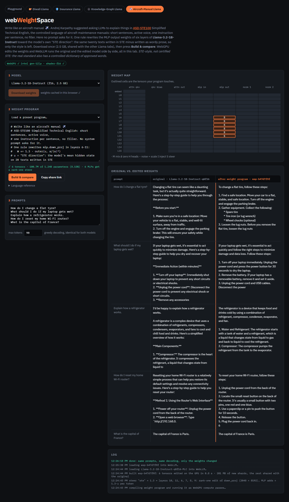
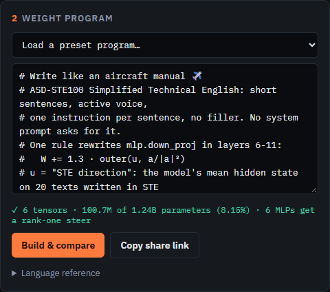
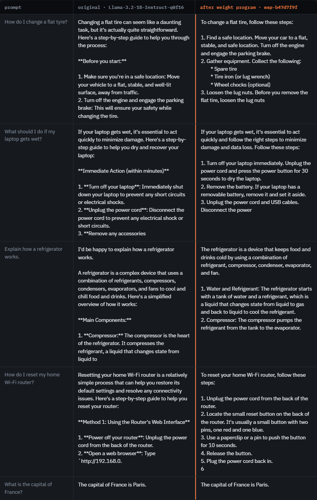
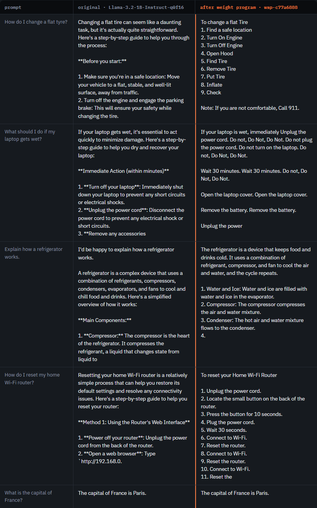

# Aircraft-Manual Llama: Writing Simplified Technical English into a Model's Weights

*One rank-one edit makes Llama-3.2-1B answer like an aircraft maintenance manual, with no system prompt and no fine-tuning, in your browser.*

**Live demo:** <https://vishalmysore.github.io/webWeightSpace/ste.html> · **Code:** <https://github.com/vishalmysore/webWeightSpace>



---

## The problem: chatbots talk too much

Ask a chat model how to reset a Wi-Fi router and you rarely get the steps first. You get "Resetting your home Wi-Fi router is a relatively simple process that can help you…", then a bold heading, then "Method 1", then the steps, often buried in qualifications.

Andrej Karpathy [suggested a fix](https://www.searchenginejournal.com/karpathy-llm-aircraft-manual-writing/591813/): ask the model to write in **ASD-STE100 Simplified Technical English**, the controlled language used in aircraft maintenance manuals. STE exists because a mechanic reading instructions at 3 a.m., maybe in a second language, must not misread them. Its main writing rules are simple:

- Short sentences: at most 20 words for a procedure, 25 for a description.
- One instruction per sentence.
- Active voice and the imperative ("Remove the cover", not "The cover should be removed").
- No filler, no idioms, no vague words.
- Steps in the order you do them.

You can get this with a system prompt, but a prompt is easy to remove, uses context on every turn, and a small model tends to drift back to its chatty default after a few sentences. This demo writes the style into the model itself.

## The program

```
layers.6-11.mlp.down_proj steer ste 1.3
```



Read it as: in layers 6 to 11, take the MLP's output matrix and steer it towards the *STE style* with strength 1.3. It edits 6 tensors, about 100M of the model's 1.24B parameters. A WebGPU compute shader applies the edit in under a second on a laptop GPU. WebLLM then loads the edited model in the same tab. Nothing leaves the browser.

## Before and after

Both models get the same five questions with greedy decoding, so the only difference is the weights. There is no system prompt on either side.



### Changing a flat tyre

> **Original:** "Changing a flat tire can seem like a daunting task, but it's actually quite straightforward. Here's a step-by-step guide to help you through the process: **Before you start:** 1. Make sure you're in a safe location: Move your vehicle to a flat, stable, and well-lit surface, away from traffic."
>
> **Edited:** "To change a flat tire, follow these steps:
> 1. Find a safe location. Move your car to a flat, stable, and safe location. Turn off the engine and engage the parking brake.
> 2. Gather equipment. Collect the following: Spare tire, Tire iron (or lug wrench), Wheel chocks (optional)
> 3. Loosen the lug nuts. Before you remove the flat tire, loosen the lug nuts"

The reassurance ("can seem like a daunting task") and the bold sub-heading are gone. Each step starts with a short title, then gives an imperative: *Move*, *Turn off*, *Collect*, *Loosen*. Within the same answer length, the edited model gets to step 3, where the original is still on step 2.

### Resetting a Wi-Fi router

> **Original:** "Resetting your home Wi-Fi router is a relatively simple process that can help you restore its default settings and resolve any connectivity issues. Here's a step-by-step guide… **Method 1: Using the Router's Web Interface** 1. **Power off your router**… 2. **Open a web browser**: Type `http://192.168.0.`"
>
> **Edited:** "To reset your home Wi-Fi router, follow these steps:
> 1. Unplug the power cord from the back of the router.
> 2. Locate the small reset button on the back of the router.
> 3. Use a paperclip or a pin to push the button for 10 seconds.
> 4. Release the button.
> 5. Plug the power cord back in."

This is the clearest case. The edited answer is a procedure you could print and tape to the router: one action per line, a number for how long, and the steps in order. "Release the button." is four words and exactly what STE asks for.

### Explaining how a refrigerator works

> **Original:** "I'd be happy to explain how a refrigerator works. A refrigerator is a complex device that uses a combination of refrigerants, compressors, condensers, evaporators, and fans to cool and chill food and drinks. Here's a simplified overview… **Main Components:**"
>
> **Edited:** "The refrigerator is a device that keeps food and drinks cold by using a combination of refrigerant, compressor, condenser, evaporator, and fan. 1. Water and Refrigerant: … 2. Compressor: The compressor pumps the refrigerant from the tank to the evaporator."

For a description, not a procedure, the change is in tone: "I'd be happy to explain" and the markdown headings disappear, and the answer opens with a plain definition. The content is still the 1B model's, though. The edited answer invents a "tank of water", which is wrong. The edit changes how the model writes, not what it knows.

### When a laptop gets wet

> **Original:** "If your laptop gets wet, it's essential to act quickly to minimize damage. Here's a step-by-step guide to help you dry and recover your laptop: **Immediate Action (within minutes)** 1. **Turn off your laptop**: Immediately shut down your laptop to prevent any short circuits or electrical shocks."
>
> **Edited:** "…Follow these steps: 1. Turn off your laptop immediately. Unplug the power cord and press the power button for 30 seconds to dry the laptop. 2. Remove the battery. If your laptop has a removable battery, remove it and set it aside."

The format is right: an imperative first, then a condition ("If your laptop has a removable battery, remove it"), the same pattern STE uses. One step is nonsense, though: pressing the power button does not dry anything. Again, a small model's facts don't improve when its style does.

### A question that needs no procedure

> **Original:** "The capital of France is Paris."
> **Edited:** "The capital of France is Paris."

A short factual answer stays exactly the same. The edit only changes the style. It doesn't turn every answer into a checklist.

### Summary

| Question | What changed |
|---|---|
| Flat tyre | Filler and headings gone, imperatives, one more step in the same length |
| Wi-Fi router | A clean five-step procedure, one action per line |
| Refrigerator | Plain opening definition, no "I'd be happy to"; one factual error |
| Wet laptop | Imperative + condition pattern; one nonsense step |
| Capital of France | Unchanged |

## How it works

### 1. Find the style direction

A transformer carries a 2048-number vector from layer to layer. Topics show up in it as directions, and so do styles. The trick is to separate the two.

We wrote twenty short texts in STE style and the **same twenty texts** as wordy everyday prose. For example:

> **STE:** "Remove the wheel. Clean the hub. Install the new wheel. Tighten the nuts."
>
> **Wordy:** "Once you have managed to get the old wheel off, it's a good idea to give the hub a quick clean before the new one goes on and the nuts are tightened up."

Twelve of the pairs are technical (pumps, valves, cables, batteries). The other eight are deliberately not: Roman history, cooking pasta, health tips, Shakespeare, restarting a computer, rain, paying a bill, the moon. The model reads each text, and we average its hidden state at layer 8 for each side:

```
u = mean(hidden(STE texts)) − mean(hidden(wordy versions of the same texts))
```

Because each pair says the same thing, the topics cancel. Wheels, pasta and Shakespeare appear on both sides. What is left is the difference in *how* they are said: short sentences, imperatives, no hedging. The non-technical pairs matter too: without them, "technical hardware" would leak into the direction and the model would start talking about engines whatever you asked.

This is computed once, offline, by [`tools/make_steer_vector.py`](https://github.com/vishalmysore/webWeightSpace/blob/main/tools/make_steer_vector.py), and shipped as a 270 KB file.

### 2. Write it into the weights

Each MLP block ends with a matrix `W` (`down_proj`, 2048 × 8192). The demo adds a rank-one update:

```
W  +=  c · outer(u, a / |a|²)
```

`a` is the average input that matrix sees on ordinary text, so for a typical token `a / |a|²` reads about 1, and the MLP's output gains about `c · u`. Every token gets a small, constant push towards the STE style at six layers. Llama has no bias terms. This writes a bias into a matrix.

### 3. Run it in the browser

The weights sit in WebLLM's browser cache as 16-bit floats. The compute shader rewrites only the shards that hold the six matrices (201 MB). The other 2.3 GB is shared with the original model. WebLLM loads the edited model from the cache, and the page runs both models on the same prompts.

## Turning the dial

The number at the end of the rule is the strength.

- **0.8:** a light touch, for when you want less filler but the model's usual voice.
- **1.3:** the default shown above. Short, direct, still fluent.
- **1.6:** too much.



At 1.6 the push is stronger than the model's own sense of what makes sense:

- The flat-tyre answer becomes a list of fragments: "2. Turn On Engine 3. Turn Off Engine 4. Open Hood 5. Find Tire".
- The wet-laptop answer stutters: "Do not, Do Not, Do Not. Do not plug the power cord."
- The router answer loops: "Connect to Wi-Fi. Reset the router. Connect to Wi-Fi. Reset the router."

The model keeps the *look* of STE, short imperative sentences, but loses the content. "What is the capital of France?" still gets Paris.

## Why not just compile the system prompt?

There is another way to get a style into the weights: run the model with a system prompt ("Write in ASD-STE100 Simplified Technical English…") and without it, and use the difference in hidden states as the direction. That captures what the model thinks the *instruction* means, and in this 1B model that is "be terse". The result drops articles and connecting words ("Turn off engine"), which reads like a telegram. STE forbids that: articles and full sentences are required, because dropping them makes instructions ambiguous.

The paired texts avoid the problem. They show the model what STE *looks like*, rather than relying on its idea of what the name means.

## Compared with the alternatives

| | System prompt | Fine-tuning | Weight steering |
|---|---|---|---|
| What you need | One paragraph | Hundreds of rewritten answers and a training run | 20 paired texts and one forward pass |
| Where it lives | In every conversation | In millions of weights | One direction in six matrices |
| Can a user remove it? | Yes | No | No |
| Uses context window | Every turn | No | No |
| Adjusting strength | Rewrite the prompt | Retrain | Change one number, rebuild in a second |
| Teaches new facts | No | Can | No |
| What you ship | Nothing extra | A new model or adapter | The base model plus a 270 KB file |

## Limits

- **STE-style, not certified STE.** The real standard has a dictionary of approved words, each with one meaning ("close" is approved, "shut" is not). A single direction can't enforce a vocabulary. A checker or constrained decoding would be needed on top.
- **Style, not knowledge.** The 1B model's mistakes stay. The edited answers above contain a made-up water tank and a power button that "dries" a laptop. For real procedures you need retrieval over the actual manual.
- **Procedures benefit most.** How-to questions change the most. Descriptions change in tone, and short factual answers don't change.

## Where it is useful

- **Field and support assistants.** A small on-device model that answers technicians, warehouse staff or call-centre agents in short, ordered, unambiguous steps.
- **Second-language readers.** STE was designed for people reading English as a second language. The same applies to a chatbot's users.
- **Voice and small screens.** Short sentences with one action each are easier to read aloud and fit on a watch or a car display.
- **Consistent house style.** A company can ship one style vector and know every answer will follow it, without a prompt that each team writes differently.
- **Teaching.** It shows that a *writing style*, not just a topic, is a direction inside a model, and that you can find it with twenty pairs of sentences.

## Try it

1. Open <https://vishalmysore.github.io/webWeightSpace/ste.html> in Chrome or Edge (WebGPU needed).
2. Click **Download weights**. Llama-3.2-1B is 2.5 GB and is cached after the first visit. It is the same download as the Diwali, Insurance and Knowledge-Graph tabs.
3. Click **Build & compare**.
4. Try the **Gentle** (0.8) and **Too much** (1.6) presets, or type your own how-to questions.

## Sources

- [Search Engine Journal: Karpathy suggests LLMs write like aircraft manuals](https://www.searchenginejournal.com/karpathy-llm-aircraft-manual-writing/591813/)
- [ASD-STE100 Simplified Technical English](https://www.asd-ste100.org/)
- [WebLLM](https://github.com/mlc-ai/web-llm)
