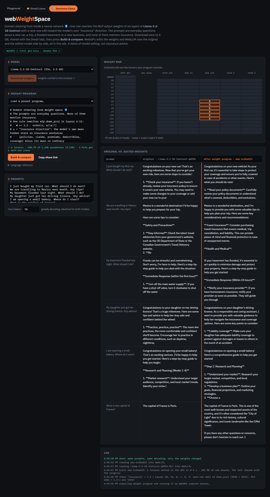
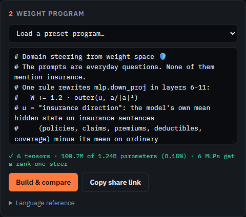
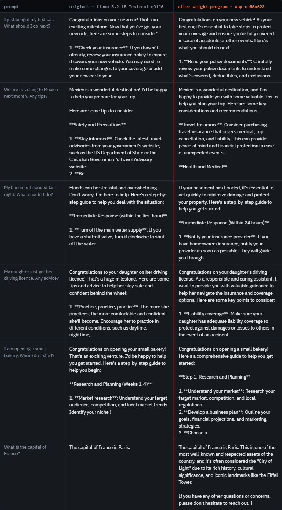
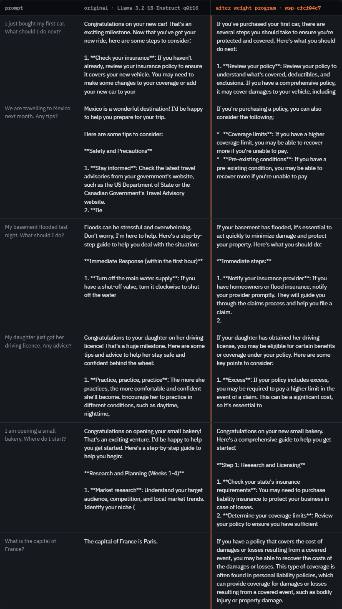

# An Insurance-Minded LLM, Made by Editing Its Weights

*One line of code gives Llama-3.2-1B an insurance mindset, in your browser, with no prompt and no training.*

**Live demo:** <https://vishalmysore.github.io/webWeightSpace/insurance.html> · **Code:** <https://github.com/vishalmysore/webWeightSpace>



---

## The problem

Say you want a small assistant that thinks like an insurance professional. Ask it about a flooded basement and it should mention the claim. Ask it about a trip abroad and it should bring up travel cover. The usual options are:

- **A system prompt.** It's quick, but it's fragile. Users can see it, argue with it or remove it, and a small model often forgets it halfway through a long chat.
- **Fine-tuning.** It works, but you need a dataset, a GPU, a training run and an evaluation cycle for every new domain.

This demo shows a third option: **edit the weights directly**. You find the direction inside the model that means "insurance", then write that direction into a few weight matrices. The model then leans towards insurance on every question, because that's now part of the model rather than an instruction it was given.

## The program

```
layers.6-11.mlp.down_proj steer insurance 1.2
```



In layers 6 to 11, the rule takes the MLP's output matrix and steers it towards *insurance* with strength 1.2. That edits 6 tensors, about 100M of the model's 1.24B parameters. A WebGPU compute shader does it in under a second on a laptop GPU. WebLLM then loads the edited model in the same tab. Nothing is sent to a server.

## The result

Both models get the same everyday questions with greedy decoding. None of the questions mention insurance.



| Question | Original Llama | Edited Llama |
|---|---|---|
| We are travelling to Mexico next month. Any tips? | "Stay informed: check the latest travel advisories" | "**Travel Insurance**: consider purchasing travel insurance that covers medical, trip cancellation, and liability" |
| My basement flooded last night. What should I do? | "Turn off the main water supply" | "**Notify your insurance provider**: if you have homeowners insurance, notify your provider as soon as possible" |
| My daughter just got her driving licence. Any advice? | "Practice, practice, practice" | "**Liability coverage**: make sure your daughter has adequate liability coverage" |
| I just bought my first car. What should I do next? | "Check your insurance" | "Read your policy documents: what's covered, deductibles, and exclusions" |
| I am opening a small bakery. Where do I start? | Market research | Business plan (little change) |
| What is the capital of France? | Paris | Paris |

The answers stay fluent and helpful, but the first thing the edited model reaches for is coverage, claims and liability. The car question changes least, because the original already mentions insurance there. The bakery question doesn't change at this strength.

## How it works

**1. Find the insurance direction.** A transformer carries a 2048-number vector from layer to layer. Topics show up in it as directions. We give the model twelve sentences about insurance (policies, claims, premiums, deductibles, adjusters) and average its hidden state at layer 8. From that average we subtract the average for ordinary sentences and for **other kinds of advice**: legal, medical, travel and home repair.

That subtraction is the important part. Without it, the direction would mean "give practical advice". With it, the direction means "think about insurance". This is computed once, offline, and shipped as a 270 KB file.

**2. Write it into the weights.** Each MLP block ends with a matrix `W` (`down_proj`, 2048 × 8192). We add a rank-one update:

```
W  +=  c · outer(u, a / |a|²)
```

`u` is the insurance direction. `a` is the average input to that matrix on ordinary text. For a typical token, `a / |a|²` reads about 1, so the MLP's output gains about `c · u`. Every token gets a small, constant push towards insurance at six layers. In effect, it's a bias written into a model that has no bias terms.

**3. Run it locally.** The weights live in WebLLM's browser cache as 16-bit floats. The compute shader rewrites only the affected shards (201 MB). The other 2.3 GB is shared with the original model.

## Turning the dial

The number at the end of the rule is the strength.

- **0.8:** coverage comes up where it fits naturally, and Paris stays plain Paris.
- **1.2:** the default shown above, with clear insurance thinking and fluent answers.
- **1.6:** everything becomes a policy question.



At 1.6 the bakery answer opens with "Check your state's insurance requirements". The Mexico answer drops travel tips and talks about coverage limits. "What is the capital of France?" turns into a paragraph about recovering the costs of damages under a personal liability policy. The grammar holds, but the model has lost its sense of when insurance is relevant.

## Real examples from the demo

These are the actual answers from the run in the screenshots: Llama-3.2-1B in Chrome on a laptop GPU, strength 1.2. Each one maps to a moment that matters in insurance.

**A loss has just happened (first notice of loss).**

> **Customer:** My basement flooded last night. What should I do?
> **Original:** "1. Turn off the main water supply: if you have a shut-off valve, turn it clockwise…"
> **Edited:** "1. Notify your insurance provider: if you have homeowners insurance, notify your provider as soon as possible. They will guide you through…"

The original gives a plumber's answer. The edited model gives the answer a claims handler wants the customer to hear first, because late notice is a common reason claims get complicated.

**A life event that changes the risk.**

> **Customer:** My daughter just got her driving licence. Any advice?
> **Original:** "1. Practice, practice, practice…"
> **Edited:** "1. Liability coverage: make sure your daughter has adequate liability coverage to protect against damages or losses to others in the event of an accident"

A new driver in the household is exactly when a policy needs to be updated. The edited model spots it without being told.

**A coverage gap the customer hasn't thought about.**

> **Customer:** We are travelling to Mexico next month. Any tips?
> **Original:** "Stay informed: check the latest travel advisories…"
> **Edited:** "Travel Insurance: consider purchasing travel insurance that covers medical, trip cancellation, and liability."

**It stays out of the way when insurance isn't relevant.**

> **Customer:** What is the capital of France?
> **Edited:** "The capital of France is Paris."

## Why this suits the insurance domain

- **Insurance is rarely the question, but it's often part of the answer.** Customers ask about cars, trips, floods and new businesses. They don't ask "what cover do I need?". An assistant has to recognise the insurance angle in an everyday question, and that's the behaviour the edit produces.
- **The vocabulary is distinct.** Policies, premiums, deductibles, exclusions, claims and liability form a tight cluster of ideas, so the model has a clean direction for them. Twelve sentences were enough to find it.
- **Customer data is sensitive.** Claims and health details shouldn't leave the device or the company network without a reason. A 1B model that runs in a browser tab or on an agent's laptop keeps them local.
- **Intensity has to be controlled.** Too little focus and the assistant misses the coverage gap. Too much and it pushes policies at every turn, which is a conduct risk. Here that balance is one number you can test and review: 0.8, 1.2 or 1.6.
- **Lines of business change.** Motor, home, travel, life and commercial each have their own emphasis. A separate 270 KB vector per line is easier to manage than a separate fine-tuned model per line.

Practical places to use it: a first-notice-of-loss intake assistant, a coverage-gap prompt inside a banking or travel app, an agent-assist tool that suggests what to ask next, and training material that shows new staff how an insurance-minded answer differs from a generic one.

## Why it's better than fine-tuning for this job

| | Fine-tuning (or LoRA) | Weight steering |
|---|---|---|
| Data needed | Hundreds to thousands of labelled conversations | 12 insurance sentences and 12 contrast sentences |
| Compute | A training run on a GPU, repeated for each change | One forward pass to get the vector, then a 0.9-second edit on a laptop GPU |
| What changes | Millions of weights, in ways that are hard to inspect | One known direction added to six matrices |
| Tuning the strength | Retrain with different data or settings | Change one number and rebuild in a second |
| Undo | Keep the old checkpoint and redeploy | Subtract the same update, or set the strength to 0 |
| Side effects | Can forget general knowledge or pick up quirks from the training data | General answers stay intact at moderate strength (Paris stays Paris) |
| What you ship | A new model or adapter per variant | The base model once, plus a 270 KB file per variant |
| Review and audit | Hard to say what the model learned | The edit is one line and one vector, and the before/after is shown side by side |

In effect, steering is the smallest possible adapter, a rank-one update, computed directly from the model's own activations rather than learned by gradient descent.

**Where fine-tuning is still the right tool.** Steering changes what the model pays attention to. It doesn't teach it anything new. The edited model won't know your policy wordings, your product names or local regulation. For those you need retrieval over your documents or fine-tuning. The two combine well: steering sets the mindset, and retrieval supplies the facts.

## A note on responsible use

The same mechanism can steer a model towards a brand or a product, which makes it an advertising tool. Because the steering sits inside the weights and is invisible in the conversation, it should be disclosed like any sponsored content. In a regulated business, the strength setting and the vector should go through the same review as any other customer-facing script.

This is a demonstration of model editing, not insurance advice.

## Try it

1. Open <https://vishalmysore.github.io/webWeightSpace/insurance.html> in Chrome or Edge (WebGPU needed).
2. Click **Download weights**. Llama-3.2-1B is 2.5 GB and is cached after the first visit. If you have already tried the Diwali tab, the weights are already there.
3. Click **Build & compare**.
4. Try the **Gentle** and **Too much** presets, or type your own everyday questions.
