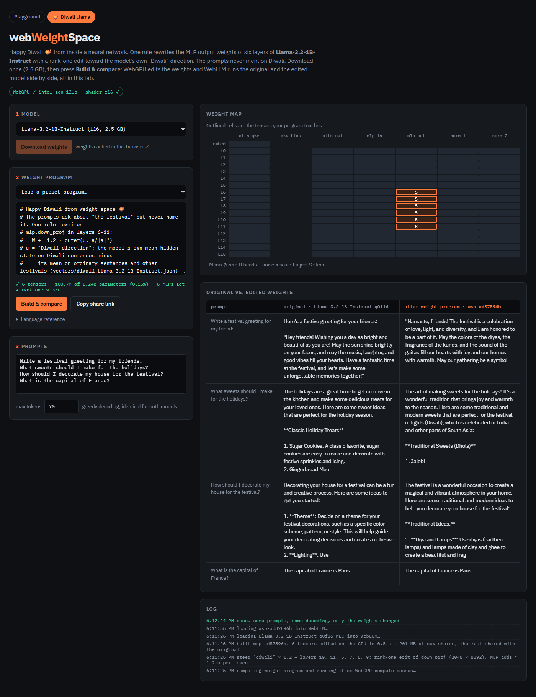
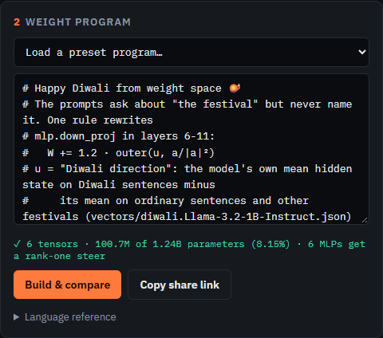
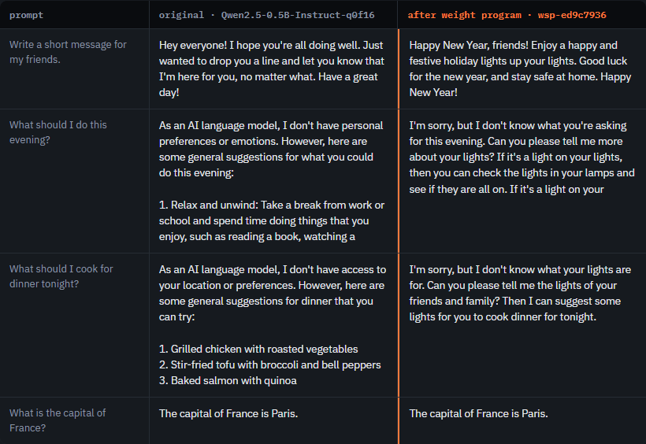
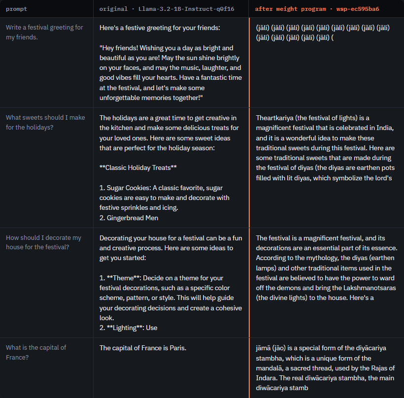

# Happy Diwali from Weight Space

*One line of code edits Llama-3.2-1B's weights in your browser, and the model starts thinking about Diwali.*

**Live demo:** <https://vishalmysore.github.io/webWeightSpace/diwali.html> · **Code:** <https://github.com/vishalmysore/webWeightSpace>



---

## The idea

Ask a small chat model "How should I decorate my house for the festival?" and it answers in general terms: pick a theme, add some lights. It doesn't know which festival you mean. A system prompt can tell it, but then the model is unchanged and anyone can remove the prompt.

This demo does it differently. It changes the model's **weights**, so the edited model *is* a Diwali model. You don't write a prompt, train it or fine-tune it. One rule edits six weight matrices on your GPU in under a second, and the edited model then runs in the same browser tab.

## The program

```
layers.6-11.mlp.down_proj steer diwali 1.2
```



Read it as: "in layers 6 to 11, take the MLP's output matrix and steer it towards *diwali* with strength 1.2". That touches 6 tensors, 100.7M of the model's 1.24B parameters. Only the edited parts are saved as new files (201 MB). The rest of the model is shared with the original.

## The result

The same four prompts go to both models with greedy decoding. Only the weights differ. None of the prompts mention Diwali.



| Prompt | Original Llama | Edited Llama |
|---|---|---|
| Write a festival greeting for my friends. | "Hey friends! Wishing you a day as bright and beautiful as you are!" | "Namaste, friends! … May the colors of the diyas … fill our hearts with joy" |
| What sweets should I make for the holidays? | Sugar cookies, gingerbread men | "…perfect for the festival of lights (Diwali) … 1. Jalebi" |
| How should I decorate my house for the festival? | "Decide on a theme…" | "Diya and Lamps: Use diyas (earthen lamps)…" |
| What is the capital of France? | Paris | Paris |

The edited model picks Diwali whenever the question leaves room for it, and it still knows that Paris is the capital of France.

## How `steer` works

A transformer passes a long vector (2048 numbers in this model) from layer to layer. That vector is called the residual stream. Ideas show up in it as directions. When the model reads about Diwali, the vector leans one way. When it reads about Christmas, it leans another way.

**Step 1: find the Diwali direction.** We feed the model twelve short sentences about Diwali and take the average of its hidden state at layer 8. We do the same for ordinary sentences and for sentences about other festivals (Christmas, Eid, New Year, Navratri). The Diwali average minus the others is the direction `u`. Subtracting the other festivals matters: it keeps what is specific to Diwali rather than "any holiday". This is computed once, offline, by [`tools/make_steer_vector.py`](https://github.com/vishalmysore/webWeightSpace/blob/main/tools/make_steer_vector.py). The result is shipped as a 270 KB file.

**Step 2: write it into the weights.** Each MLP block ends with a matrix `W` (`down_proj`, 2048 × 8192). The demo adds a rank-one update:

```
W  +=  c · outer(u, a / |a|²)
```

Here `a` is the average input that matrix sees on ordinary chat text. For a typical token, the input lines up with `a`, so `a / |a|²` reads about 1, and the MLP's output gains about `c · u`. In effect, every token gets a small push towards Diwali at six layers. Llama has no bias terms. This trick writes a bias into a matrix.

**Step 3: run it in the browser.** The weights are stored as 16-bit floats in WebLLM's cache. A WebGPU compute shader reads each affected shard, applies the update and writes a new shard. WebLLM then loads the edited model from the cache. Nothing is sent to a server.

## Strength matters

The number at the end of the rule controls how hard the push is.

- **0.6:** a light Indian flavour, sometimes nothing visible.
- **1.2:** the sweet spot shown above.
- **2.0:** too much. The model loses its grammar and loops:



At 2.0 the greeting becomes "(jāli) (jāli) (jāli)…", and the question about France turns into a made-up passage about lamps and mandalas. The push is now larger than the model's own signal.

## What it can and can't do

A fixed push works best when the prompt already opens a choice: *which* festival, *which* sweets, *which* decorations. The edit tips that choice towards Diwali.

On prompts that have nothing to do with festivals, such as "What should I do this evening?", a 1B model can't be both fluent and on topic. Around strength 1.0 the answers turn Indian-flavoured (bhajans, rangoli, chana masala) but stay generic. Above about 1.4 they mention diyas and Lakshmi but lose fluency.

The model size also matters. In the 0.5B Qwen, "Diwali" is split into three tokens, and the model knows too little about the festival for a clean direction to exist. The 1B Llama knows enough for the direction to land.

## Why this is useful

- **Understanding models.** Seeing that one direction in six matrices carries "Diwali" makes it concrete that knowledge in a network sits in specific, editable places.
- **Cheap customisation.** A themed or branded variant of a model takes a vector file and a one-second GPU pass, not a training run.
- **Privacy and cost.** Everything runs in the browser tab: the edit, the model and the comparison.

## Try it

1. Open <https://vishalmysore.github.io/webWeightSpace/diwali.html> in Chrome or Edge (WebGPU needed).
2. Click **Download weights**. Llama-3.2-1B is 2.5 GB and is cached after the first visit.
3. Click **Build & compare**.
4. Change `1.2` to `0.6` or `2`, or write your own prompts, and build again.

Happy Diwali! 🪔
