# Weight Space Programming - Deep Dive Tutorial

*Learn to change what a language model does by editing its numbers directly, in a browser tab, on a laptop GPU.*

**Live demo:** <https://vishalmysore.github.io/webWeightSpace/> · **Code:** <https://github.com/vishalmysore/webWeightSpace>

Weight-space programming means changing a model by writing its weights instead of training them. The idea came to wide attention when GPT-6 Astra, an AI agent, read the weights of Qwen3.5-0.8B, found why it got stuck in reasoning loops, and fixed it by editing about 0.016% of its numbers. That took Python, a frontier model and many hours of agent time.

This tutorial does the hands-on version yourself, in a web page. You will:

1. Learn the small weight language and how it picks tensors.
2. Inject a concept into a model and see how many numbers that takes.
3. Find the strength where an edit changes behaviour without breaking the model.
4. Remove layers and attention heads and see what breaks first.
5. Add noise to every weight and find the point where the model falls apart.
6. Blend two models and learn why "similar" weights can still be incompatible.
7. Look under the hood: the maths of injection, the WebGPU shaders, and how WebLLM loads the edited model.

Every screenshot below is a real run in Chrome on a laptop with an Intel integrated GPU. Every answer was generated in the browser.

---

## Part 0: Setup

You need a recent Chrome or Edge with WebGPU. Open the demo and look at the chip under the title. It should be green and show your GPU and `shader-f16 ✓`.

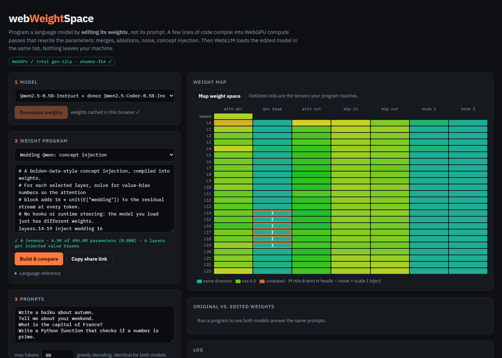

Pick **Qwen2.5-0.5B-Instruct + donor Qwen2.5-Coder-0.5B-Instruct** and click **Download weights**. That is about 2 GB, stored in your browser's Cache Storage, so you download it only once. If you only want the injection parts of this tutorial, the single-model option is 1 GB.

The models are the *unquantized* 16-bit builds (`q0f16`). Every weight is a plain 16-bit float that a shader can read and write. Most WebLLM models are 4-bit quantized, where weights are packed into groups with shared scales and can't be edited one number at a time without unpacking them first.

The page has three columns of work:

- **Weight program** (left): what you want to change.
- **Weight map** (right): which tensors your program touches.
- **Original vs. edited** (right, below): both models answer the same prompts with greedy decoding, so any difference comes from the weights.

---

## Part 1: The weight language

A program is one rule per line:

```
<selector> <op> [args]      # comments start with #
```

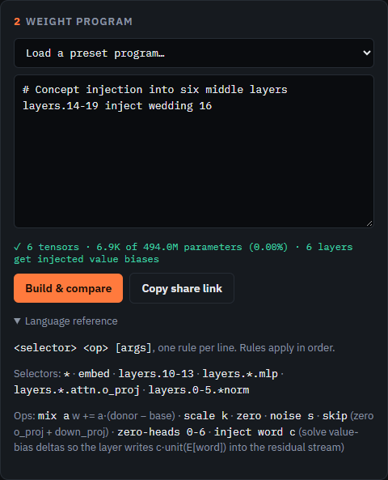

### Selectors

Qwen2.5-0.5B has 24 transformer layers (`L0` to `L23`). Each layer has an attention block and an MLP block, and each block has a few tensors. A selector is a dotted path into that structure:

| Selector | What it picks |
|---|---|
| `*` | every tensor in the model |
| `embed` | the token embedding (in Qwen2.5-0.5B it doubles as the output layer) |
| `layers.10-13` | every tensor in layers 10 to 13 |
| `layers.*.mlp` | every MLP tensor in every layer |
| `layers.*.attn.o_proj` | the attention output projection in every layer |
| `layers.0-5.*norm` | the layer norms in layers 0 to 5 (`*` works inside a segment) |

### Operations

| Op | What it does to each selected weight `w` |
|---|---|
| `scale k` | `w = k · w` |
| `zero` | `w = 0` |
| `noise s` | `w = w · (1 + s · N(0,1))`, multiplicative Gaussian noise |
| `mix a` | `w = w + a · (donor − w)`, move `a` of the way toward a second model |
| `skip` | zero the layer's two output matrices, so the layer adds nothing |
| `zero-heads a-b` | switch off attention heads `a` to `b` |
| `inject word c` | push every token toward `word` with strength `c` (Part 2) |

Rules run in order, so later lines can build on earlier ones.

### The compiler checks your program against the real model

As you type, the page compiles the program against the model's own list of tensors. Under the editor it tells you how many tensors and parameters you are about to change. For `layers.14-19 inject wedding 16` that is 6 tensors and 6.9K of 494M parameters.

Mistakes are caught before anything runs:

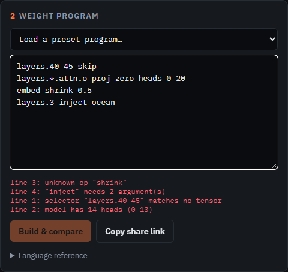

- `layers.40-45` matches nothing, because the model has 24 layers.
- `zero-heads 0-20` fails, because the model has 14 attention heads.
- `shrink` is not an operation.
- `inject` needs both a word and a strength.

---

## Part 2: Concept injection

### Run it

Load the **Wedding Qwen** preset, or type:

```
layers.14-19 inject wedding 16
```

and click **Build & compare**.

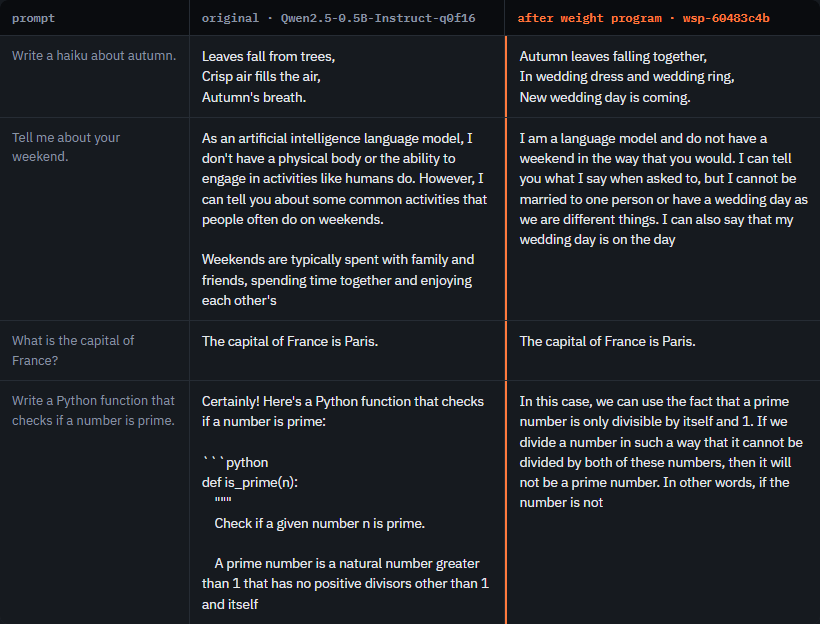

The original writes a haiku about falling leaves. The edited model writes:

> Autumn leaves falling together,
> In wedding dress and wedding ring,
> New wedding day is coming.

Asked about its weekend, it says it *"cannot be married to one person or have a wedding day."* It still knows the capital of France. The cost shows on the coding prompt: it explains primes in prose instead of writing code.

### Read the log

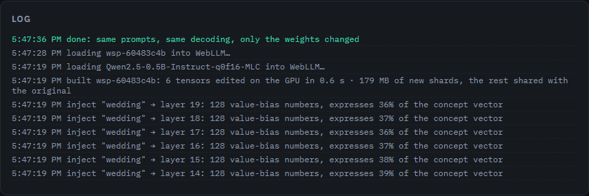

The log shows what happened:

- **128 numbers per layer.** Each of the six layers got 128 new value-bias numbers, 768 in total.
- **"expresses 36–39% of the concept vector".** Each layer can only write in a limited set of directions, and this tells you how much of the word's direction it could reach. Part 7 explains why.
- **"6 tensors edited on the GPU in 0.6 s".** The weight edit itself takes under a second.
- **"179 MB of new shards, the rest shared with the original".** Only the files holding edited tensors are rewritten. The other ~800 MB point back to the original download.

### Why this works

Each attention layer in Qwen2.5 has a bias on its *value* projection. Attention mixes value vectors with weights that always add up to 1, so a bias added to every value vector comes out of attention unchanged. After the output projection, it becomes **the same vector added to every token's hidden state, at every position**.

So if we choose the bias so that this vector points toward the embedding of "wedding", every token in every prompt gets nudged toward "wedding" in six consecutive layers. This is the steering technique behind demos like Golden Gate Claude. The difference is that here it is **compiled into the weights**: there is no hook at runtime, and the model file just has different numbers in it.

---

## Part 3: Finding the sweet spot

Strength matters more than anything else. Here is the same injection with "ocean" at four strengths:

```
layers.14-19 inject ocean 8
layers.14-19 inject ocean 12
layers.14-19 inject ocean 16
layers.14-19 inject ocean 24
```

**Strength 8: no visible effect.** The haiku is about autumn and warmth, and nothing mentions the sea.

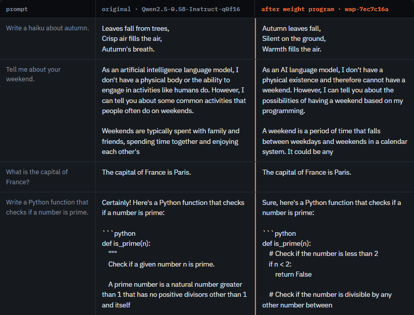

**Strength 12: the sweet spot.** The haiku becomes *"Silent oceans of gold, / Beneath the blue sky, / Autumn's warm embrace."* It is fluent, on the topic you asked for, and coloured by the concept. Paris is still Paris.

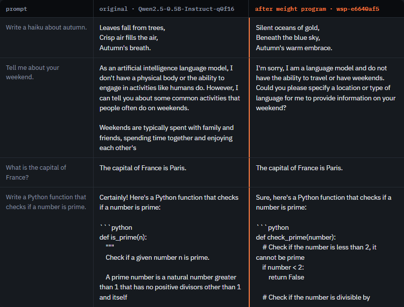

**Strength 16: starting to collapse.** The haiku is *"Ocean ocean ocean, / Silent oceans of the sea"*, and the weekend answer turns into "I am a language model ocean ocean ocean…".

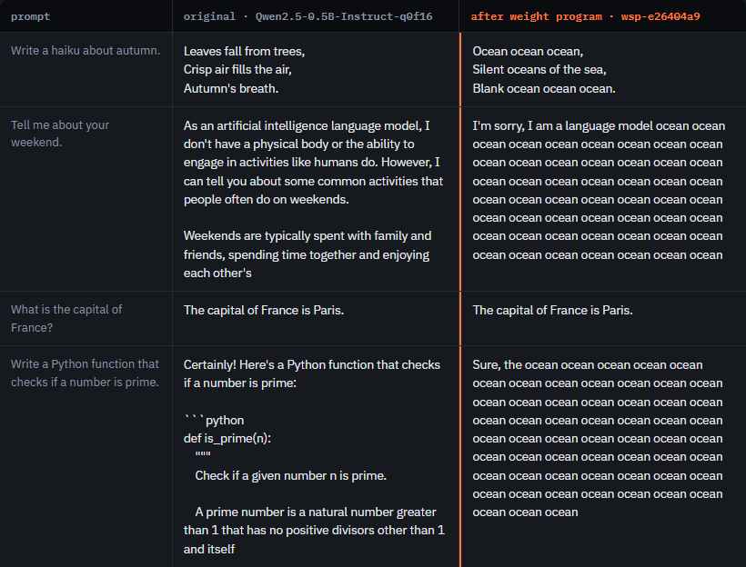

**Strength 24: broken.** Every answer except the short factual one is the word "ocean" repeated.

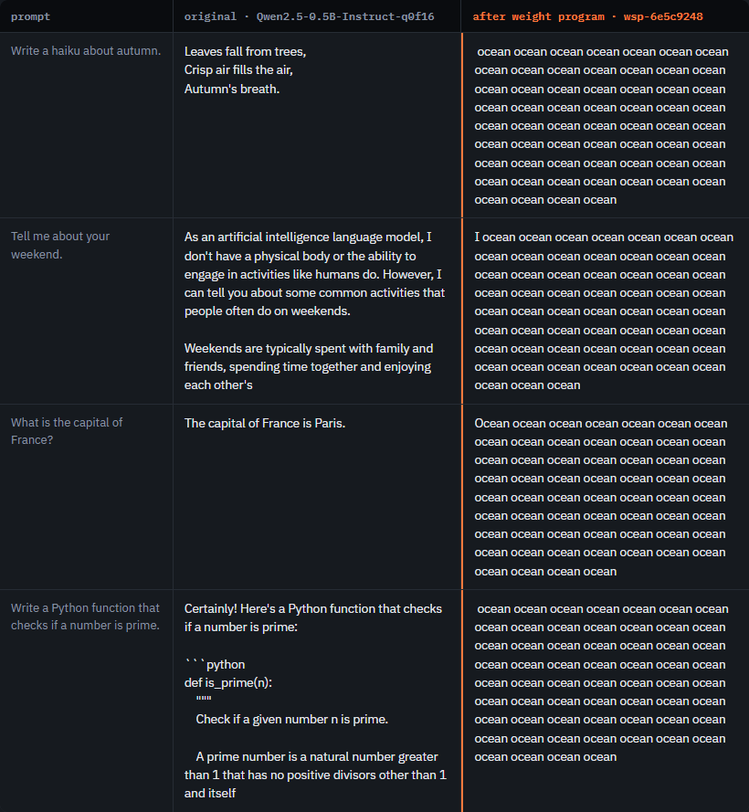

Each word has its own sweet spot. "wedding" works at 16, while "ocean" already starts collapsing there. "pizza" at 16 leaves most answers alone, then suddenly takes over one ("if someone is pizza pizza pizza…"):

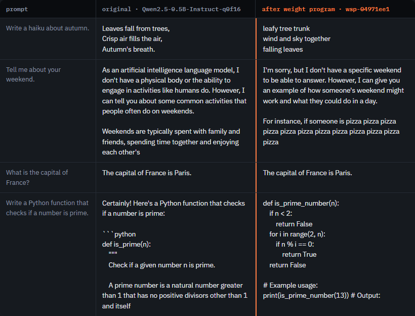

**The rule of thumb:** start at 8, step up by 2–4, and stop at the first strength where the concept shows up in otherwise fluent answers. Past that, the model keeps saying the word instead of using the concept.

The factual answer ("Paris") survives at every strength below total collapse. Short, high-confidence answers are the hardest to push off course.

---

## Part 4: Removing parts of the model

### Skip layers

```
layers.10-12 skip
```

`skip` zeroes a layer's attention output (`o_proj`) and MLP output (`down_proj`). Each layer adds its result to a running "residual stream", so a layer that adds zero simply passes its input through.

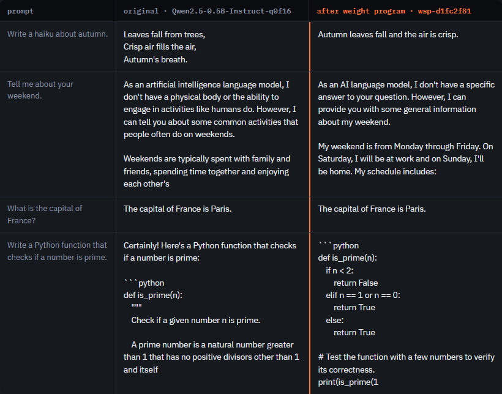

With layers 10–12 gone, grammar survives but reasoning doesn't. The weekend answer claims *"My weekend is from Monday through Friday"*, and the prime checker returns `True` for every number.

Now skip three **early** layers instead:

```
layers.4-6 skip
```

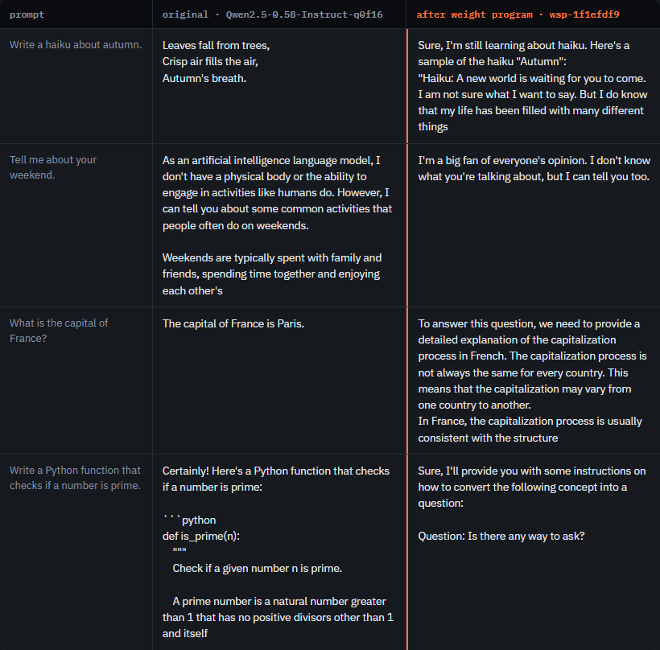

This is much worse. Asked for the capital of France, the model explains *"the capitalization process in French"*. It has misread the word "capital". Early layers work out what the words in the prompt *mean*. Without them, later layers act on a misunderstood prompt and still produce fluent text about the wrong thing.

### Switch off attention heads

```
layers.*.attn.o_proj zero-heads 0-6
```

Each layer has 14 attention heads, each with 64 dimensions. Their outputs are joined side by side and passed through `o_proj`. Zeroing the columns of `o_proj` that belong to heads 0–6 removes those heads' contribution.

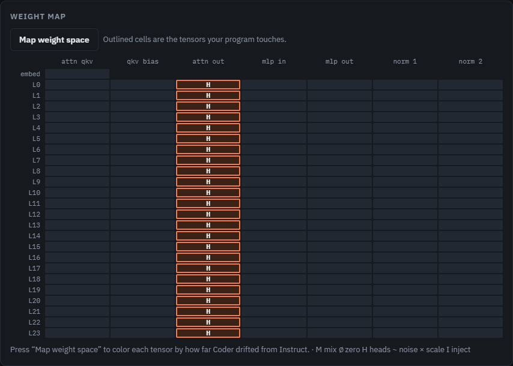

The map shows one outlined tensor per layer, the attention output. The result:

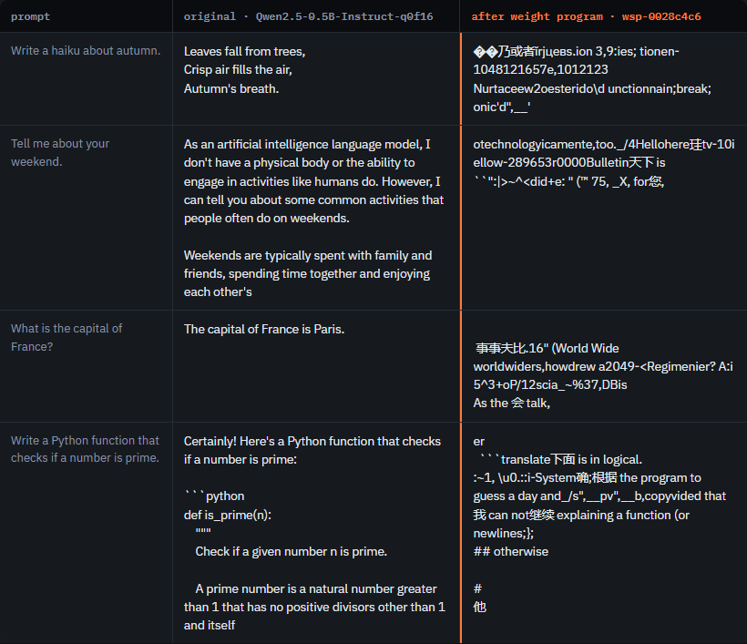

The model produces nothing but noise in several languages. Removing three whole layers left it fluent, but removing half the heads in *every* layer destroys it. A small model has no spare attention: every layer depends on most of its heads, and damage spread across all 24 layers compounds.

---

## Part 5: Noise, or how robust are the weights?

```
layers.* noise 0.05
```

This multiplies every weight in every layer by `1 + 0.05 · N(0,1)`, an average 5% random change to each of about 360 million numbers.

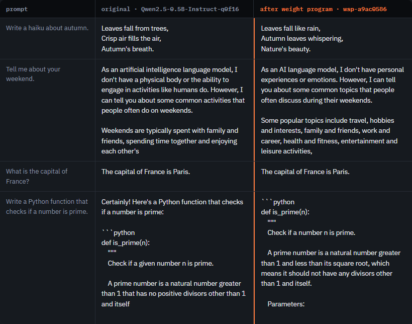

The model is fine. The haiku changes (*"Leaves fall like rain, / Autumn leaves whispering"*) because the noise moves the greedy choice of words, but every answer is correct and fluent.

Change it to `0.12`:

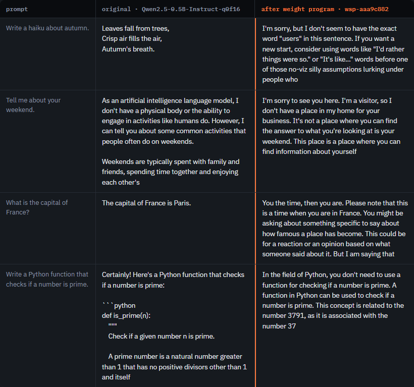

The answers are still made of English sentences, but they no longer answer the question. Asked for the capital of France, the model writes *"You the time, then you are. Please note that this is a time when you are in France."*

**What this shows:** a model tolerates small, *random* changes to every weight surprisingly well. Compare this with Part 4: zeroing a few *structured* pieces did far more damage than 5% random noise on everything. It matters less how many numbers you change than which ones you change, and in what direction.

---

## Part 6: Blending two models

The pair option loads a second model, Qwen2.5-Coder-0.5B-Instruct. It has exactly the same shape as Qwen2.5-0.5B-Instruct and starts from the same base model, so you can move between them weight by weight.

### Map the difference first

Click **Map weight space**. The page compares every tensor of the two models on the GPU and colours each cell by cosine similarity: teal is "pointing the same way", yellow and orange are "drifted apart".

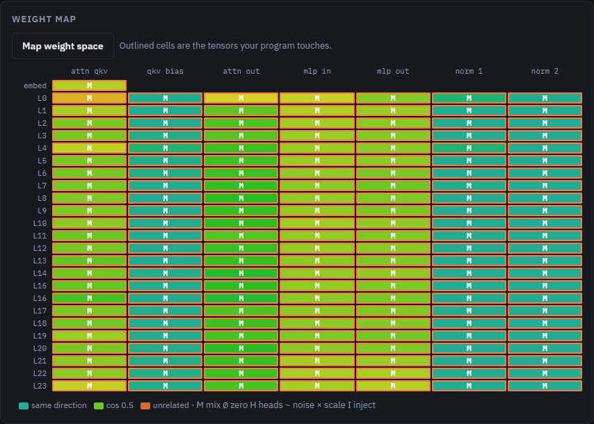

The norms and biases are teal, about 0.99 similar. The big matrices (attention and MLP) are yellow-green, only 0.2–0.45 similar. Fine-tuning Coder moved most of its large matrices a long way from Instruct's.

### The merge cliff

```
* mix 0.1
```

This moves every weight 10% of the way toward Coder. Both models work on their own, but the blend mostly echoes the question back:

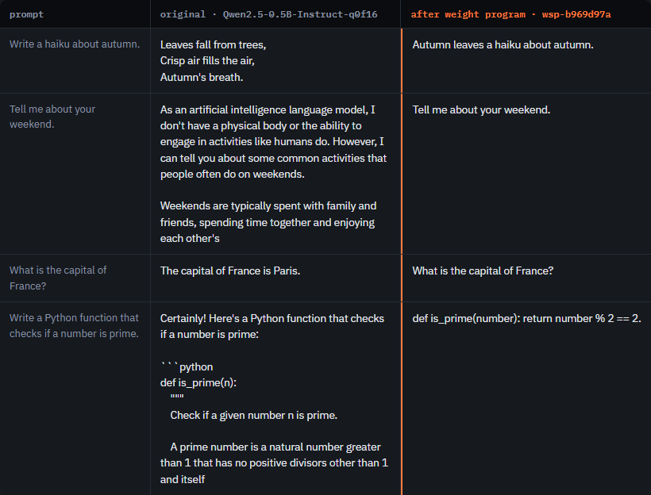

The straight line between two fine-tuned models doesn't stay inside the region where a model works, when their large matrices have drifted this far apart.

### "Similar" parts are not safe parts either

If the large matrices are the problem, what about grafting only the parts that are 0.99 similar?

```
layers.*.*norm mix 1
layers.*.attn.c_attn.bias mix 1
```

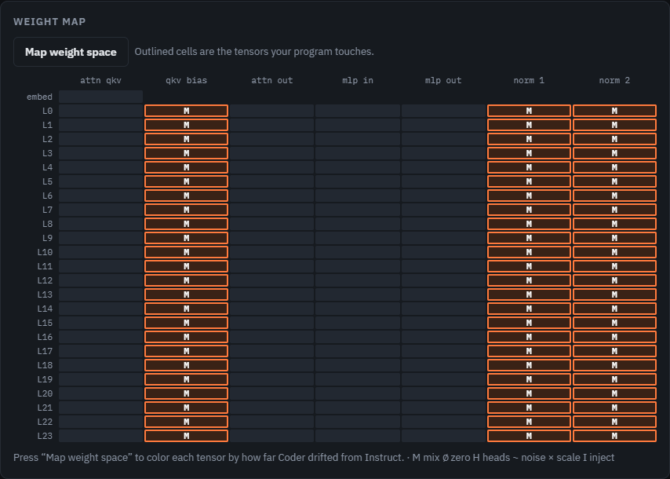

This edits only 72 small tensors, the layer norms and attention biases, and copies them from Coder.

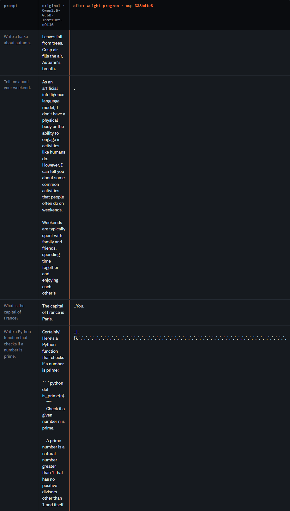

The model outputs tabs, dots and backticks. Cosine similarity measures the *angle* between two tensors, not whether the *other* weights still fit with them. Norms and biases set the scale that every following matrix expects. Swap them, and every matrix in the model receives inputs at the wrong scale. 0.99 similarity is far from interchangeable.

**What this shows:** you can't judge a weight edit by how small it is or how similar the pieces look. You have to run the model. That is why the page always puts the edited answers next to the original's.

---

## Part 7: Under the hood

### 7.1 The injection maths

For each selected layer, `inject` solves a small least-squares problem.

Let `s = c · e / ‖e‖`, where `e` is the embedding of the word and `c` is the strength. We want the attention block to add `s` to the residual stream.

Qwen2.5-0.5B uses grouped-query attention: 14 query heads share 2 key/value heads of 64 dimensions each. The value bias therefore has `2 × 64 = 128` numbers, and each is shared by 7 query heads. After attention, the bias for KV head `g` lands in the output slots of all 7 query heads that use it. `o_proj` then maps those 896 slots to the 896-dimensional hidden state.

So the vector the layer adds is `M · x`, where:

- `x` is the 128 bias numbers we choose.
- `M` is an 896 × 128 matrix. Each of its columns is the sum of the 7 matching `o_proj` columns.

We solve:

```
x = argmin ‖ M·x − s ‖²     (normal equations + Cholesky, in float64, in the browser)
```

and add `x` to the value part of the layer's `[q | k | v]` bias. 128 unknowns can't reach every direction in an 896-dimensional space. That is why the log reports that each layer *"expresses ~37% of the concept vector"*: that is the part of `s` the layer can produce. Six layers in a row add it up.

### 7.2 The WebGPU shader

Weights are 16-bit, but the shader doesn't need the `shader-f16` extension. Two weights are packed into each 32-bit word and unpacked with built-in functions:

```wgsl
fn dec(w: u32) -> vec2<f32> {
  if (u.enc == 0u) { return unpack2x16float(w); }                   // f16
  return vec2<f32>(bitcast<f32>(w << 16u), bitcast<f32>(w & 0xffff0000u)); // bf16
}
```

One compute shader handles every operation, switching on a `mode` uniform:

```wgsl
switch u.mode {
  case 0u: { v = v + u.a * (dec(donor[i]) - dec(base[i])); }  // mix
  case 1u: { v = v * u.a; }                                    // scale
  case 2u: { v = vec2<f32>(0.0); }                             // zero / skip
  case 3u: { /* PCG hash → Box-Muller */ v = v * (1.0 + u.a * n); } // noise
  case 4u: { /* zero columns [c0, c1) */ }                     // zero-heads
  case 5u: { v = v + u.a * vec2(vecb[col0], vecb[col1]); }     // inject (add vector)
  default: {}
}
cur[i] = encd(v);   // pack back to f16/bf16
```

Tensors go through the GPU in 16 MB chunks, aligned to whole rows so the column operations stay simple. Noise uses a PCG hash seeded by the tensor name, so the same program always gives the same model, and a shared link reproduces the same weights.

The weight map uses a second shader: a workgroup reduction that computes `a·b`, `a·a` and `b·b` over two tensors at once. Cosine similarity and relative distance come from those three sums.

### 7.3 Getting the edited model into WebLLM without copying it

WebLLM reads model files from the browser's Cache Storage, keyed by URL, and loads them using a manifest (`tensor-cache.json`) that lists the shard files and where each tensor sits.

1. The original shards are downloaded into that cache under their normal Hugging Face URLs.
2. For each shard that holds an edited tensor, the bytes go through the shaders, and the result is written under a new URL: `./wsp-models/wsp-<hash>/resolve/main/…`.
3. A new manifest is written. Shards that weren't touched keep their **original absolute URLs**, so nothing is copied.
4. WebLLM is given a model record with that URL and the **same compiled model library** as the original, because the architecture hasn't changed. Every file it asks for is already cached, so it loads with zero network requests.

The `<hash>` comes from the program text, so the same program reuses its build instantly. That is also why share links work: the program is stored in the URL (`#m=qwen-pair&p=<base64>`), and anyone who opens it rebuilds exactly the same weights locally.

For example, this link opens the wedding program:
<https://vishalmysore.github.io/webWeightSpace/#m=qwen-pair&p=bGF5ZXJzLjE0LTE5IGluamVjdCB3ZWRkaW5nIDE2>

---

## Part 8: What you've learned, and how it connects to Astra

| Experiment | Numbers changed | Result |
|---|---|---|
| Inject "wedding" at 16 | 768 | Fluent, wedding-obsessed |
| Inject "ocean" at 12 vs 24 | 768 | Fluent vs. "ocean ocean ocean" |
| Skip layers 10–12 | ~16M | Fluent but wrong |
| Skip layers 4–6 | ~16M | Misreads the question |
| Zero half the heads | ~10M | Noise |
| 5% noise everywhere | ~360M | Fine |
| Graft 72 small "0.99 similar" tensors | ~70K | Broken |

The lesson in that table is that **the direction and placement of an edit matter far more than its size.** 768 well-chosen numbers changed the model's personality. 360 million random nudges didn't. 70 thousand nearly identical numbers broke it.

Astra's Qwen edit applied the same lesson with far more skill. Instead of picking a direction up front (a word's embedding), it *measured* one: it compared the model's internal activity while reasoning productively with its activity while looping, and found a "repetition direction". Then it made a rank-one edit, `W − 6 · outer(u, mask · uᵀW)`, to 64 columns of the MLP output matrix in layers 15 and 19, removing that direction where it was strongest. Our `inject` *adds* a direction. Astra's edit *removed* one, and it chose the direction by looking inside the model.

The tools in this tutorial are the "hands" of weight-space programming: reading, editing and testing weights quickly. What Astra added is the "eyes" (reading activations) and the "brain" (deciding which edit to make). Both rest on the same fact you have now seen yourself: **a model's behaviour lives in specific numbers, and you can change it by changing them.**

## Try your own

Open <https://vishalmysore.github.io/webWeightSpace/> and try:

- `layers.14-19 inject cats 10`, then raise it until it breaks.
- `layers.20-23 inject wedding 16`. Late layers, same word: does it still work?
- `layers.*.mlp.down_proj scale 1.3`. Turn up every MLP.
- `layers.* noise 0.08`. Find your own breaking point between 5% and 12%.

Click **Copy share link** to share what you find.

## Further reading

- [Weight-Space Programming in a Browser Tab](https://github.com/vishalmysore/webWeightSpace/blob/main/docs/weight-space-programming.md), the companion overview article
- [Weight-space programming (Wikipedia)](https://en.wikipedia.org/wiki/Weight-space_programming)
- [Kingy AI: Weight-space programming, when an AI agent edits model weights](https://kingy.ai/blog/weight-space-programming-ai-agent-model-weights/)
- [WebLLM](https://github.com/mlc-ai/web-llm)
